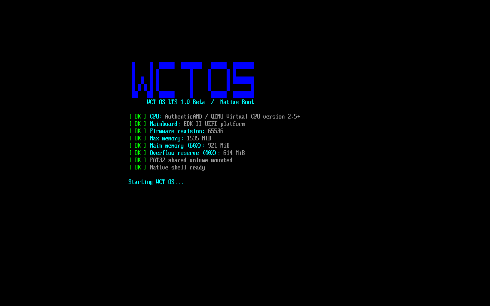
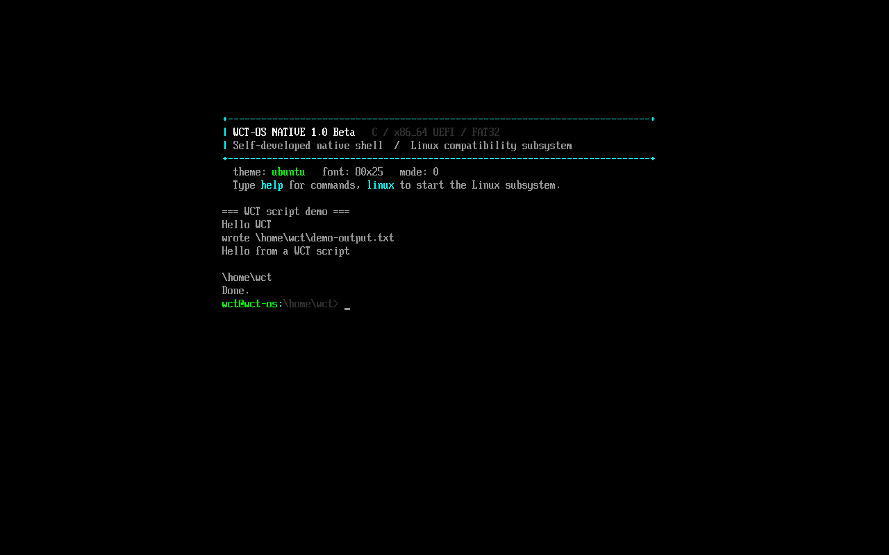
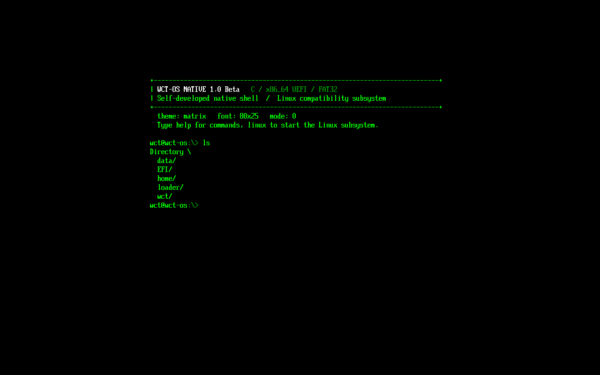
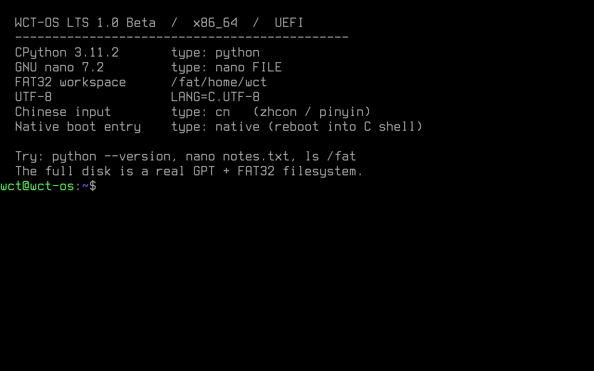

# WCT-OS LTS 1.0

一个 **GPT + FAT32 UEFI 镜像**里包含两套系统：

1. **WCT-OS Native**：自研的纯 C UEFI 原生环境，**内置图形桌面环境（GUI）**，开机默认进入原生终端。
2. **WCT-OS Linux**：内嵌的 Linux 兼容子系统，提供 CPython、nano、中文输入和完整 POSIX 环境。

原生终端执行 `linux` 会直接启动内嵌的 Linux 子系统；Linux 里执行 `native` 会重启回到原生终端。两套系统共享同一块 FAT32 文件系统。










## 启动

原生启动会先通过 GOP 清除主板 BIOS 遗留的开机 Logo，再显示蓝色 WCT-OS 方块 Logo，下方依次检测 CPU、主板平台、固件、最大内存，并按 60% 主内存 / 40% 防溢出预留显示结果；日志结束后等待 3 秒进入原生终端。

- **QEMU 完整版**：双击 `start.cmd`，或运行 `run.ps1`。
- **QEMU 无 Linux 版**：双击 `start-no-linux.bat`。
- **实体机**：用 Rufus DD 模式或 `dd` 将 `dist/WCT-OS-LTS-1.0.img` 写入 U 盘，使用 **UEFI 启动**并关闭 **Secure Boot**。
- 当前为 UEFI 启动；传统 Legacy/CSM 不支持。

开机流程：

```text
UEFI firmware
  -> EFI\BOOT\BOOTX64.EFI          (自研 C 原生终端 + GUI)
       ├─ 普通命令：文件操作、查看 FAT32
       ├─ gui 命令：进入 WCT-OS 图形桌面
       └─ linux 命令
            -> wct\bootx64.efi     (systemd-boot)
            -> wct\vmlinuz + initrd.img
            -> WCT-OS Linux 兼容子系统
                 └─ native 命令 -> reboot -> 回到自研原生终端
```

## 原生终端命令

```text
help              ls [PATH]       cat FILE
cd [DIR]          pwd             run FILE.wct
write FILE TEXT   rm FILE         cp SRC DST
mkdir DIR         edit FILE       new FILE
sleep N           theme [NAME]    font [N|next]
theme [NAME]      font [N|next]   banner
date              hw              mem 128
mem free          ver             clear
log               ps              pid
kill PID          poweroff        reboot
linux             native          gui
exitgui           tty
```

默认主题：`wct`；可切换 `ubuntu / wct / matrix / amber / ice`。字体/控制台模式：`font` 或 `font next`。
日志：`log` 查看开机和操作日志，`log clear` 清空。

原生终端直接通过 UEFI Simple File System 读写同一块 FAT32，因此 `ls \home\wct`、`cat \home\wct\WELCOME.TXT` 都可使用。

### 包系统与 API

```text
pkg list                 列出已安装包
pkg install FILE         安装 .wct / .wctpkg 脚本包
pkg run NAME             运行包
pkg remove NAME          删除包
pkg info NAME            查看包内容

api list                 列出系统 API
api call METHOD ARGS     调用 API
```

包是放在 FAT32 `\packages` 目录中的 `.wct`/`.wctpkg` 脚本。`.wctpkg` 可以在文件头声明元数据，安装后会自动加入 `help` / `pkg list` / `api call cmd.list`。包可以通过 `api call` 控制终端、任务和文件：

```text
api call term.write Hello
api call term.clear
api call task.list
api call task.kill 3
api call fs.ls \home\wct
api call pkg.list
api call cmd.list
api call cmd.ps
```

安装后的包文件名（去掉扩展名）会自动成为一个命令。例如安装 `hello.wct` 后直接输入 `hello` 即可执行。`api call cmd.NAME` 可以调用任意原生命令，`term.exec` 可以执行整条命令。

安装后的命令会出现在：

```text
pkg list
help                 底部的 Package commands
api call cmd.list    底部的 package commands
```

如果命令没有出现，先检查：

```text
pkg list
cat \packages\hello.wct
pkg run hello
```

| API | 作用 |
| --- | --- |
| `term.write TEXT` | 在终端打印一行文字 |
| `term.color NAME` | 设置终端文字颜色 |
| `term.clear` | 清屏并重绘标题 |
| `term.banner` | 重绘 WCT-OS 标题 |
| `term.exec CMD` | 执行一整条终端命令 |
| `task.list` | 显示原生进程表 |
| `task.kill PID` | 结束进程，PID 1/2 受保护 |
| `task.poweroff` | 保存日志、显示 Logo 并关机 |
| `fs.ls [PATH]` | 列出 FAT32 目录 |
| `fs.cat FILE` | 显示文件内容 |
| `fs.write FILE TEXT` | 覆盖写入一行 |
| `fs.cp SRC DST` | 复制文件 |
| `fs.rm FILE` | 删除文件 |
| `fs.mkdir DIR` | 创建目录 |
| `pkg.list` | 列出已安装包 |
| `pkg.run NAME` | 运行包 |
| `sys.hw` | 显示 CPU、固件、内存信息 |
| `sys.log [ARGS]` | 查看/写入/清空/保存日志 |
| `cmd.list` | 列出全部原生命令 |
| `cmd.NAME ARGS` | 调用指定原生命令 |

---

## 🖥️ 桌面 GUI

```text
gui       进入 WCT-OS 桌面
exitgui   在桌面命令行输入，返回终端
```

桌面运行在 UEFI GOP framebuffer 上，**双缓冲 + 局部刷新**，不依赖文本模式。鼠标通过 **PS/2 端口级驱动** 或 **UEFI Simple Pointer / Absolute Pointer 协议** 读取。`run.ps1` 会添加 USB tablet，以便 QEMU 下鼠标事件进入固件。

### 桌面组成

- **壁纸**：6 种可选 —— 纯色 / 渐变 / 网格 / 动态 / 纸纹 / 星夜
- **桌面图标**：自动生成，显示每个已注册应用（8 个内置应用）
- **开始菜单**：左下角「开始」按钮，包含文件 / 终端 / 设置 / 任务管理器 / 运行 / 关于 / 锁屏 / 重启 / 关机
- **任务栏**：底部显示已打开窗口，点击切换焦点
- **系统时钟**：任务栏右侧实时显示
- **右键菜单**：桌面空白处右键，可「刷新桌面 / 新建文件夹 / 新建文本文档」

### 窗口管理

- 多窗口叠放，点击置顶
- 拖动标题栏移动窗口（幽灵框预览，零闪烁）
- 点击 `X` 关闭窗口
- 焦点窗口边框高亮为主题色

### 内置应用

| 应用 | 类型 | 功能 |
|------|------|------|
| 文件管理器 | `WIN_FILES` | 浏览 FAT32、进入目录、打开 `.txt`、删除、刷新 |
| 终端 | `WIN_TERM` | GUI 内嵌 tty2，支持全部原生命令 |
| 文本编辑器 | `WIN_EDIT` | 按行编辑，`Ctrl+S` 保存 |
| 设置 | `WIN_SET` | 主题、壁纸、语言切换 |
| 任务管理器 | `WIN_TASK` | 进程列表、新建进程、结束进程 |
| 关于 | `WIN_ABOUT` | 系统信息与构建信息 |
| 运行框 | `WIN_RUN` | 图形化命令执行入口，可切换管理员模式 |
| 计算器 | `WIN_CALC` | 支持 `+ - * /` 的表达式求值 |

### 主题（6 种）

- **紫色**（`purple`）
- **绿色**（`wct`，默认）
- **矩阵绿**（`matrix`）
- **琥珀**（`amber`）
- **蓝色**（`ice`）
- **纸片风**（`paper`，浅色主题）

切换方式：

```bash
theme wct
theme matrix
theme paper
```

或在「设置」应用内可视化切换。

### 壁纸（6 种）

纯色 / 渐变 / 网格 / 动态 / 纸纹 / 星夜。在「设置」应用内切换。

### 中英双语（i18n）

所有窗口标题、菜单、按钮、提示文字均支持中英双语。在「设置」应用内一键切换。

### 快捷键

| 快捷键 | 功能 |
|--------|------|
| `F12` | 关闭 GUI 返回终端 |
| `F13` | 反转鼠标方向（调试） |
| `↑ / ↓ / ← / →` | 键盘选择桌面图标 |
| `Enter` | 打开选中的图标 |
| `Ctrl+S` | 编辑器内保存 |
| `Ctrl+Q` | 编辑器内退出 |
| `Ctrl+X` | 编辑器内保存并退出 |

鼠标不可用时仍可用键盘操作桌面。

### 应用注册系统（可插拔）

WCT-OS 的 GUI 应用采用**可插拔注册**架构：只需实现应用并实例化 `AppDef`，在 `registry.h` 中注册即可。桌面图标、开始菜单、任务栏、窗口标题都会**自动同步**。

```c
typedef struct {
    int type_id;                          /* 类型 ID */
    const CHAR16 *title_zh;               /* 中文标题 */
    const CHAR16 *title_en;               /* 英文标题 */
    int def_w, def_h;                     /* 默认尺寸 */
    void (*icon_draw)(int x, int y);      /* 图标绘制 */
    void (*on_draw)(GuiWin *w);           /* 绘制回调 */
    void (*on_click)(GuiWin *w, int lx, int ly);  /* 点击回调 */
    void (*on_key)(GuiWin *w, EFI_INPUT_KEY key); /* 键盘回调 */
} AppDef;
```

添加新应用只需两步：

1. 在 `apps.h` 中实现 `AppDef` 实例
2. 在 `registry.h` 的 `g_apps[]` 数组中追加

---

## USB 存储

```text
ls \                根目录会显示 usb0/、usb1/ 等挂载目录
cd \usb0            进入第一块 USB 存储
cd \usb1            进入第二块 USB 存储
usb                 列出 UEFI 可见的 USB 挂载
usb N               直接进入 usbN
usb boot            返回启动根目录
usb rescan          重新扫描（插入 U 盘后使用）
```

USB 存储通过主板 UEFI 固件驱动访问，需要 FAT32 文件系统。挂载后它只是根目录下的 `usb0/`、`usb1/` 虚拟目录；对该目录执行 `ls`、`cat`、`cp`、`pkg` 等操作就是操作 U 盘。

## 关于

```text
about
```

显示作者 `aqtwWCT95` 和 WCT 内核版本 `4.0.441`。

---

## .wctpkg 元数据

```text
#!wctpkg
# name: Hello
# version: 1.0.0
# author: aqtwWCT95
# command: hello
# description: print a green greeting
# color: green

api call term.write Hello from a .wctpkg package
```

- `command`：安装后生成的命令名
- `version`：显示在包列表和 `pkg info`
- `author`：作者
- `description`：帮助列表中的说明
- `color`：包运行时自动切换文字颜色
- 元数据行都是注释，不会被执行

终端颜色 API：

```text
color green
color cyan
color reset
api call term.color purple
```

支持：`black`、`blue`、`green`、`cyan`、`red`、`magenta`、`brown`、`gray`、`darkgray`、`lightblue`、`lightgreen`、`lightcyan`、`lightred`、`purple`、`yellow`、`white`。

## 日志

```text
log                     查看开机日志和本次终端操作日志
log info|warn|error TEXT 写入一条指定级别日志
log save                保存到 WCT-年-月-日.LOG
log clear               清空日志
```

日志带 `HH:MM:SS` 时间戳，级别为 `[INFO]`、`[WARN]`、`[ERROR]`。日志会自动保存到 FAT32 根目录，格式为 `WCT-YYYY-MM-DD-N.log`。每次启动 N 从 1 开始递增：当天第一次启动是 `-1.log`，下一次启动是 `-2.log`，同一次启动内持续更新同一个文件。开机日志包含 CPU、主板平台、固件、最大内存、60/40 内存划分和 FAT32 初始化；之后执行过的命令也会记录在 `[cmd]` 条目里。

## 进程管理

```text
ps           列出原生进程表
pid          当前 shell 的 PID
kill PID     结束指定进程（1/2 受保护）
sudo kill PID 强制结束受保护进程
poweroff     保存日志、显示 Logo 后关机
```

原生层没有内核调度器，`ps` 显示的是 WCT 原生终端维护的进程表（wct-init / wct-shell），没有 wct-bg 占位进程。

**图形任务管理器**（任务管理器应用）与 `ps` 共享同一份进程表，可以在 GUI 中新建 / 结束进程。

## 硬件信息与内存占用

```text
hw               显示 CPU、固件、内存和终端信息
mem              查看内存
mem 128          占用 128 MiB 内存
mem free         释放占用
```

`mem` 按 MiB 计算，范围 1–4096。占用的内存会一直保留到 `mem free` 或重启。`hw` 和 `mem` 都可以直接写进 `.wct` 脚本。

---

## Linux 兼容子系统

输入 `linux` 后进入。包含：

- CPython 3.11.2（`python`）
- GNU nano 7.2（`nano`）
- Bash、coreutils、BusyBox
- UTF-8 中文环境 + zhcon 拼音输入法
- Linux 6.1 内核
- FAT32 挂载于 `/fat`，用户目录 `/home/wct`
- `native` 命令：重启回原生 WCT-OS

常用命令：

```bash
python --version
python
nano notes.txt
ls /fat
cn
native
```

### 中文输入

```bash
cn
```

zhcon 热键：

| 热键 | 功能 |
| --- | --- |
| `Alt+Space` | 开/关 CJK 模式 |
| `Ctrl+Space` | 开/关输入法 |
| `Ctrl+Alt+1` … `9` | 切换输入法（第 1 个为全拼） |
| `Ctrl+Alt+0` | 英文模式 |
| `Ctrl+D` | 退出 zhcon |

---

## 文件系统

镜像使用真实的 **GPT + FAT32**：

- 裸机固件和两套系统都从同一 FAT32 分区启动。
- 原生终端看到的是 FAT32 根目录（`\`）。
- Linux 子系统把该分区挂载为 `/fat`。
- `/home/wct` 是 `/fat/home/wct` 的链接；文件由 nano/Python 写入后重启仍然存在。
- 分区里同时有 `EFI/`、`loader/`、`wct/`、`home/`、`data/`。

---

## 目录结构

```text
dist/WCT-OS-LTS-1.0.img   256 MiB，UEFI 可启动（含 Linux 子系统）
no-linux/WCT-OS-Native-Only-1.0.img   64 MiB 纯原生版，无 Linux

native/                         自研 C 原生终端 + GUI
├── main.c                      主入口、启动流程、Shell 命令
├── gui.inc                     GUI 核心：窗口管理、事件循环、捕获层
├── app_api.h                   应用定义（AppDef 结构体）
├── apps.h                      内置应用实现
├── registry.h                  应用注册中心（g_apps 数组）
├── icons.h                     应用图标绘制
├── window.h                    窗口外壳绘制
├── desktop.h                   桌面、图标、任务栏、开始菜单
├── drag.h                      窗口拖拽幽灵框特效
├── theme.h                     主题配色
├── wallpaper.h                 壁纸绘制
├── i18n.h                      中英文字符串表
├── gfx.h                       图形底层
├── font8x16.h                  8×16 ASCII 点阵
├── wct_zh.h                    Noto Sans CJK 16×16 中文点阵
├── ps2.c                       PS/2 鼠标端口级驱动
└── efi.h                       UEFI 协议声明

linux/                          Linux 兼容子系统构建脚本与根文件系统
start.cmd / run.ps1             QEMU + OVMF 启动
build.cmd / build.ps1           完整构建
build-native-only.cmd / .ps1    只构建 64 MiB 纯原生镜像
```

---

## 构建

需要：

- MinGW-w64 GCC（编译自研原生 UEFI 应用）
- Python 3
- QEMU + OVMF（运行）
- 可访问 `http://deb.debian.org/debian/`
- Windows `curl.exe`

运行 `build.cmd`：

1. 编译 `native/main.c` 为 `native/build/native.efi`；
2. 下载并裁剪 Debian 软件包，生成 initramfs；
3. 生成 GPT + FAT32 镜像，写入原生 EFI、Linux 内核、initramfs 和启动配置。

---

## 边界

原生 WCT-OS 目前是一个 **freestanding C / UEFI 原生用户环境**，现在已包含：

- 完整的 **图形桌面环境（GUI）**：窗口管理器、任务栏、开始菜单、主题、壁纸、i18n
- **可插拔应用注册系统**：8 个内置应用，可无限扩展
- 原生 **PS/2 鼠标驱动** + UEFI 指针协议支持
- 自带终端、FAT32 文件操作、包系统、脚本引擎、日志系统
- Linux 子系统加载器

但还不是带进程调度、虚拟内存和驱动的完整内核。内嵌的 Linux 子系统用于提供当前真正可用的 CPython、nano、中文输入和 POSIX 工具链。两者在一个镜像里，但边界清晰。

---

## 光标、cd 与 WCT 脚本

原生终端启用了闪烁的硬件文本光标，提示符会显示当前目录：

```text
wct@wct-os:\home\wct> _
```

`cd` 支持相对路径、绝对路径、`.` 和 `..`：

```text
cd \home\wct
cd script-demo
cd ..
pwd
```

提示符下按 **↑ / ↓** 浏览最近 16 条命令。

输入命令或路径时，右侧蓝色文字是自动联想结果；按 **Tab** 接受补全，命令名、文件名和目录名都支持。

### 终端编辑器

```text
new note.txt      # 直接创建一个空文件
edit note.txt     # 文件不存在时自动创建
```

`edit` 打开不存在的文件会立即创建空文件，然后进入编辑器。

编辑器内命令：

```text
a TEXT        追加一行
m             多行输入：Enter 换行，空行结束
i N TEXT      在第 N 行前插入
r N TEXT      替换第 N 行
d N           删除第 N 行
l             显示内容
w             保存
wq            保存并退出
q             保存并退出（兼容习惯）

快捷键：
Ctrl+S        保存
Ctrl+Q        强制退出，不保存
Ctrl+X        保存并退出
```

### .wct 脚本

用 `run FILE.wct` 执行脚本。内置示例在 `/home/wct/demo.wct`：

```bash
run demo.wct
```

支持的行：

```text
# 注释
set NAME VALUE
echo TEXT $NAME
cd PATH
pwd
ls [PATH]
cat FILE
write FILE TEXT
mkdir DIR
rm FILE
theme ubuntu|wct|matrix|amber|ice
font N|next
hw
mem 128
mem free
sleep 1..5
while CONDITION
  ...
end
inc NAME [N]
break
continue
clear
date
linux
```

### while 循环

```text
set i 0
while $i < 5
  echo Count: $i
  inc i
end
echo Done.
```

支持的条件：

```text
while true
while $i < 5
while $i <= 5
while $i == 5
while $i != 5
while $i > 0
while exists \path\file
```

`inc NAME [N]` 让数值变量增加 N（默认 1）。循环体用 `end` 结束；支持 `break` 和 `continue`，最多执行 10000 次防止死循环。内置示例：`/home/wct/while.wct`。

示例：

```text
theme matrix
set PROJECT wct-demo
echo Building $PROJECT
cd \home\wct
write readme.txt Hello from WCT script
cat readme.txt
```

脚本中的变量会在 `echo` 和普通命令参数中展开。

---

## 许可证

```
Copyright (C) 2026  aqtwWCT95

This program is free software: you can redistribute it and/or modify
it under the terms of the GNU Affero General Public License as published
by the Free Software Foundation, either version 3 of the License, or
(at your option) any later version.

This program is distributed in the hope that it will be useful,
but WITHOUT ANY WARRANTY; without even the implied warranty of
MERCHANTABILITY or FITNESS FOR A PARTICULAR PURPOSE.  See the
GNU Affero General Public License for more details.
```

完整许可证请见 <https://www.gnu.org/licenses/agpl-3.0>。